# BankingApp

A Spring Boot microservice for managing bank accounts and their customers. It exposes the same domain three ways: a REST API, a Spring Data REST API, and a GraphQL API.

## Tech stack

- Java 17
- Spring Boot 4.1.1 (Web MVC, Data JPA, Data REST, GraphQL)
- H2 in-memory database
- Lombok
- springdoc-openapi (Swagger UI)
- Maven

## Project structure

```
src/main/java/ma/lafnoune/bankingapp
├── BankingAppApplication.java      # Entry point + sample data seeding
├── Entities/
│   ├── BankAccount.java            # JPA entity
│   ├── Customer.java               # JPA entity
│   └── AccountProjection.java      # Spring Data REST projection "p1"
├── enums/
│   └── AccountType.java            # CURRENT_ACCOUNT, SAVING_ACCOUNT
├── DTO/
│   ├── BankAccountRequestDTO.java
│   └── BankAccountResponseDTO.java
├── Mappers/
│   └── AccountMapper.java          # Entity -> DTO mapping
├── Repositories/
│   ├── BankAccountRepository.java
│   └── CustomerRepository.java
├── Services/
│   ├── AccountService.java
│   └── AccountServiceImpl.java
├── Web/
│   ├── AccountRestController.java        # REST API (/api)
│   └── BankAccountGraphQLController.java # GraphQL API
└── exceptions/
    └── CustomDataFetcherExceptionResolver.java # GraphQL error handling

src/main/resources
├── application.properties
└── graphql/schema.graphqls
```

## Domain model

**Customer**

| Field          | Type                | Notes                                         |
|----------------|---------------------|-----------------------------------------------|
| `id`           | `Long`              | Auto-generated (`IDENTITY`)                   |
| `name`         | `String`            |                                               |
| `bankAccounts` | `List<BankAccount>` | `@OneToMany(mappedBy = "customer")`, write-only in JSON to avoid infinite recursion |

**BankAccount**

| Field       | Type          | Notes                                  |
|-------------|---------------|----------------------------------------|
| `id`        | `String`      | UUID, generated by the service         |
| `createdAt` | `Date`        |                                        |
| `balance`   | `Double`      |                                        |
| `currency`  | `String`      |                                        |
| `type`      | `AccountType` | `CURRENT_ACCOUNT` or `SAVING_ACCOUNT`  |
| `customer`  | `Customer`    | `@ManyToOne`                           |

One customer owns many bank accounts.

## Getting started

```bash
./mvnw spring-boot:run
```

The app runs on `http://localhost:8080`. On startup it creates four customers (Mohammed, Achraf, Chaimaa, Hanae), each with 10 bank accounts that have a random type and balance, in `MAD`.

## Useful URLs

| Tool       | URL                                         |
|------------|---------------------------------------------|
| H2 console | http://localhost:8080/h2-console (JDBC URL: `jdbc:h2:mem:account-db`) |
| Swagger UI | http://localhost:8080/swagger-ui.html       |
| GraphiQL   | http://localhost:8080/graphiql              |

## REST API (`/api`)

Goes through the service layer and returns DTOs.

| Method   | Endpoint                  | Description          |
|----------|---------------------------|----------------------|
| `GET`    | `/api/bankAccounts`       | List all accounts    |
| `GET`    | `/api/bankAccounts/{id}`  | Get one account      |
| `POST`   | `/api/bankAccounts`       | Create an account    |
| `PUT`    | `/api/bankAccounts/{id}`  | Update an account    |
| `DELETE` | `/api/bankAccounts/{id}`  | Delete an account    |

Example request body:

```json
{
  "balance": 5000,
  "currency": "MAD",
  "type": "SAVING_ACCOUNT"
}
```

## Spring Data REST

Repositories are also exposed automatically:

- `GET /bankAccounts`: paginated list of accounts
- `GET /bankAccounts?projection=p1`: only `id`, `type` and `balance`
- `GET /bankAccounts/search/byType?t=CURRENT_ACCOUNT`: filter by type
- `GET /customers`: list of customers

## GraphQL API (`/graphql`)

Schema: `src/main/resources/graphql/schema.graphqls`

**Queries**

```graphql
query {
  accountList { id balance currency type customer { id name } }
}

query {
  bankAccountById(id: "<account-id>") { id balance type }
}

query {
  customers { id name bankAccounts { id balance type } }
}
```

**Mutations**

```graphql
mutation {
  addAccount(bankAccount: { balance: 5000, currency: "MAD", type: "SAVING_ACCOUNT" }) {
    id createdAt balance
  }
}

mutation {
  updateAccount(id: "<account-id>", bankAccount: { balance: 9000 }) {
    id balance
  }
}

mutation {
  deleteAccount(id: "<account-id>")
}
```

Exceptions thrown during GraphQL execution (for example "Bank account X not found") are converted into readable GraphQL errors by `CustomDataFetcherExceptionResolver`.


## Tests

Tests réalisés le 22/11/2026 dans le navigateur, avec l'application lancée en local (`http://localhost:8080`) : Swagger UI pour l'API REST, GraphiQL pour GraphQL, et la console H2.

### API REST (`/api`)

**Lister tous les comptes**

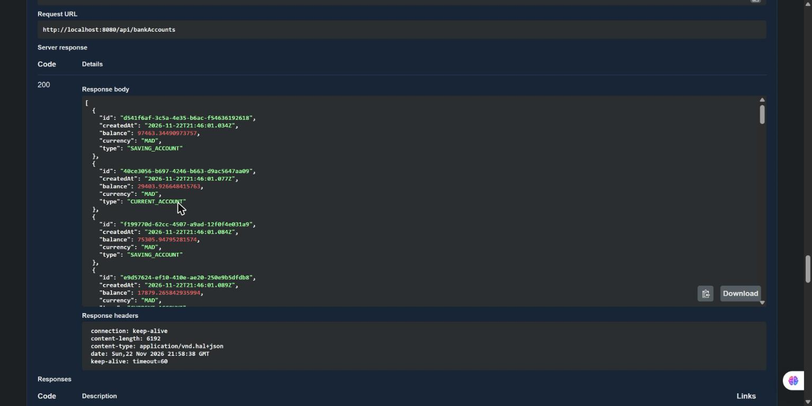

**Consulter un compte par id**

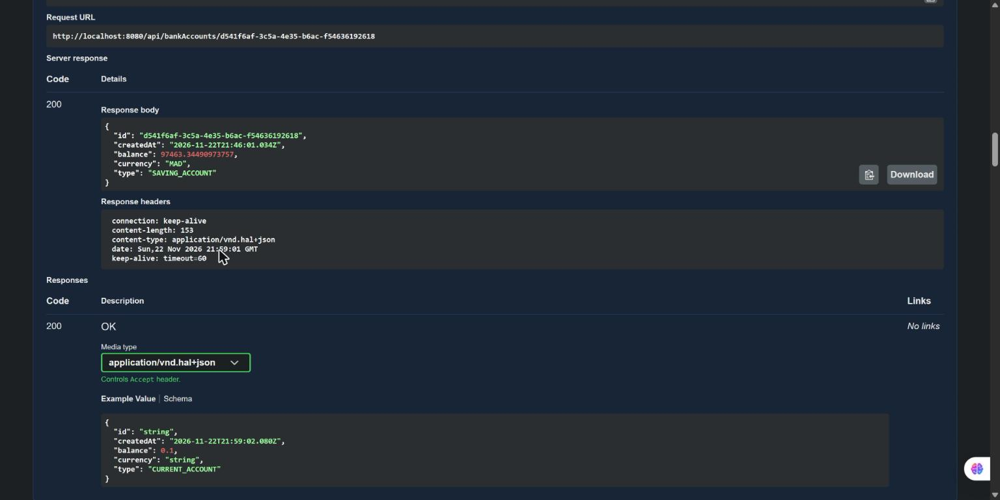

**Créer un compte**

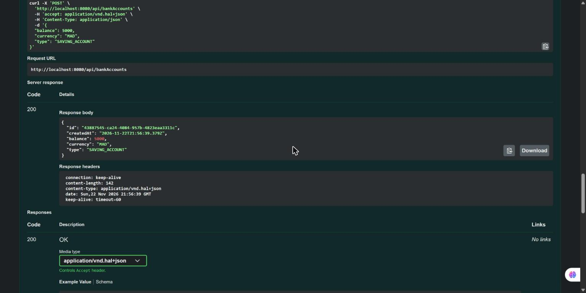

**Modifier un compte**

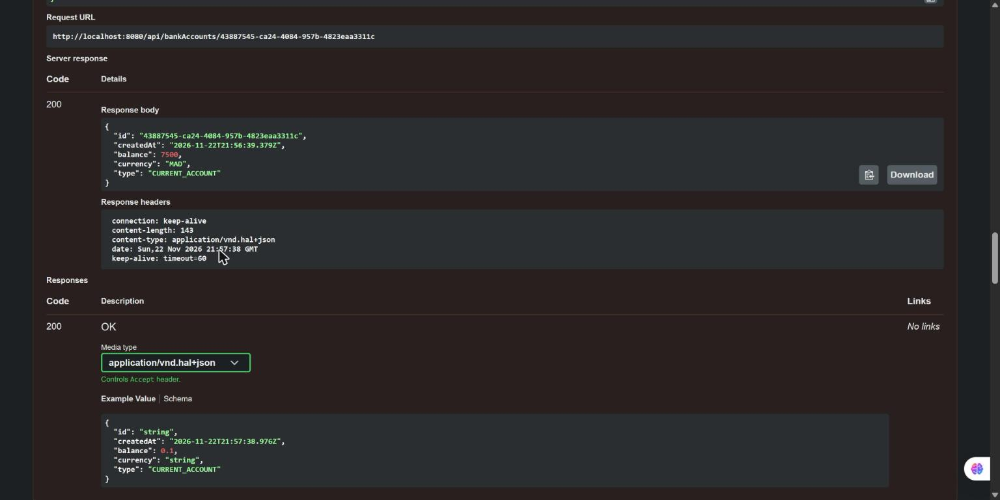

**Supprimer un compte**

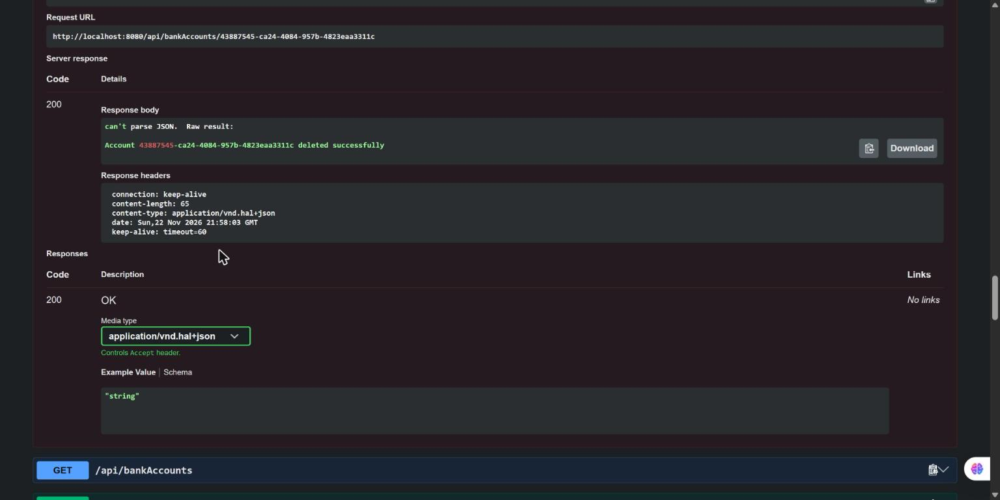

**Consulter le compte supprimé (404 Not Found attendu)**

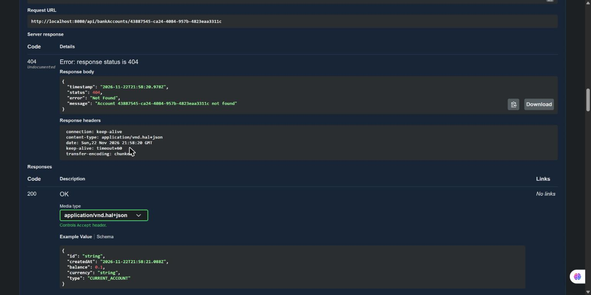

### Spring Data REST

**Liste paginée des comptes**

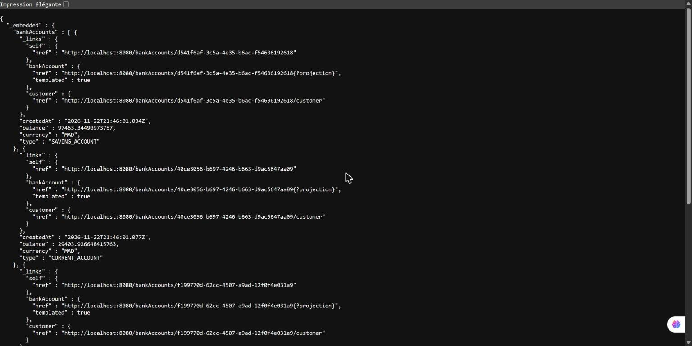

**Projection p1**

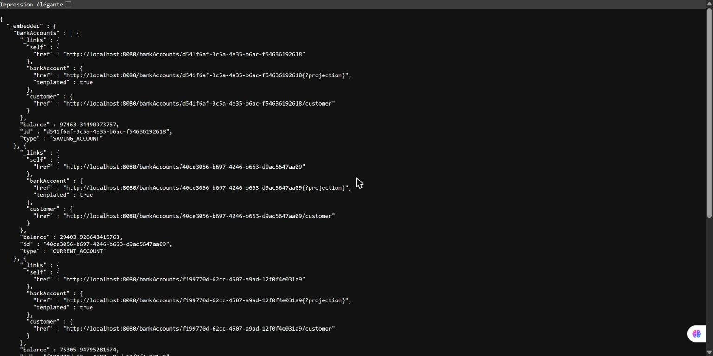

**Recherche par type**

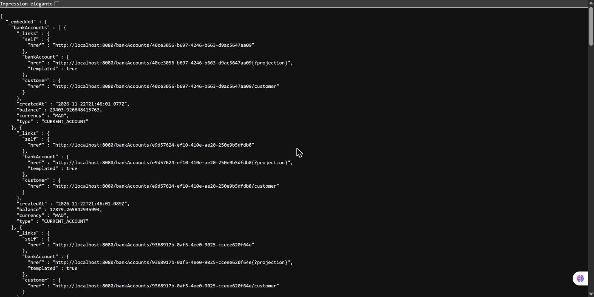

**Liste des clients**

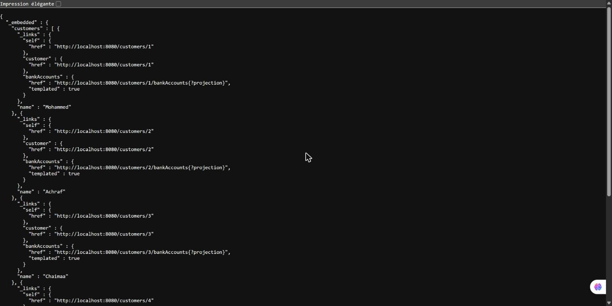

### GraphQL (`/graphql`)

**Query accountList**

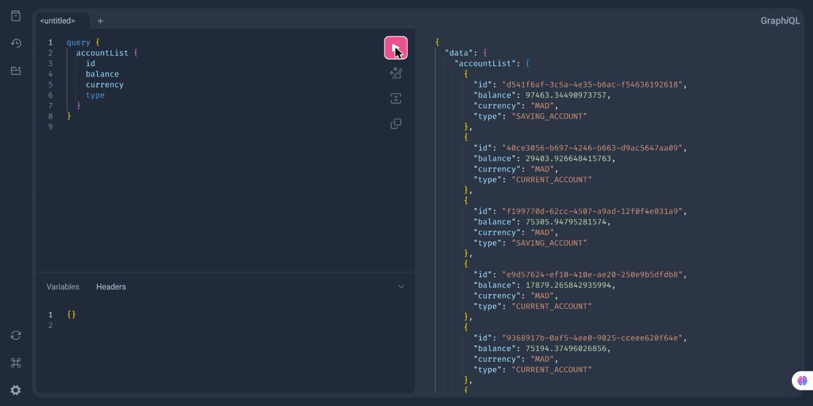

**Query bankAccountById**

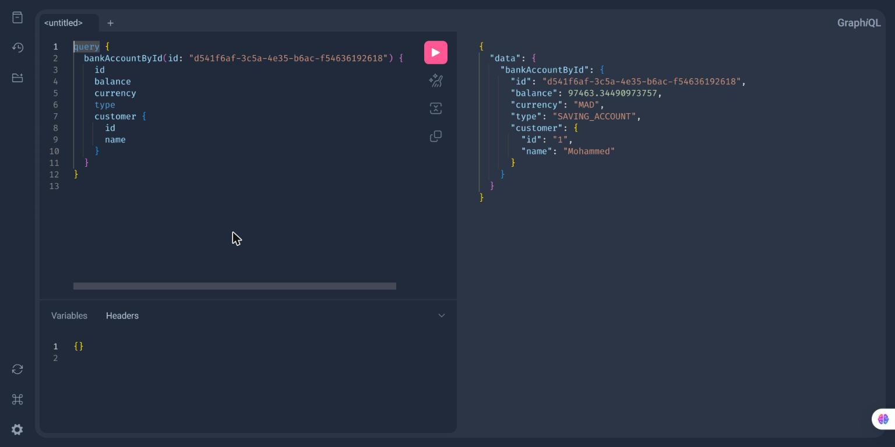

**Query customers**

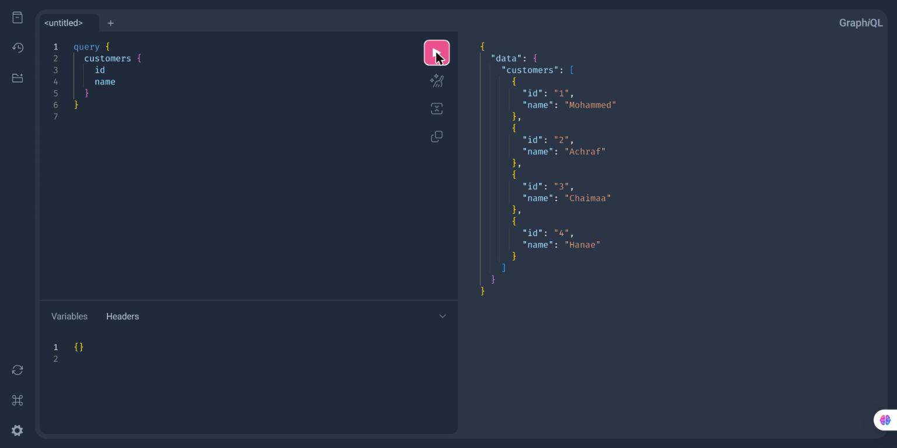

**Mutation addAccount**

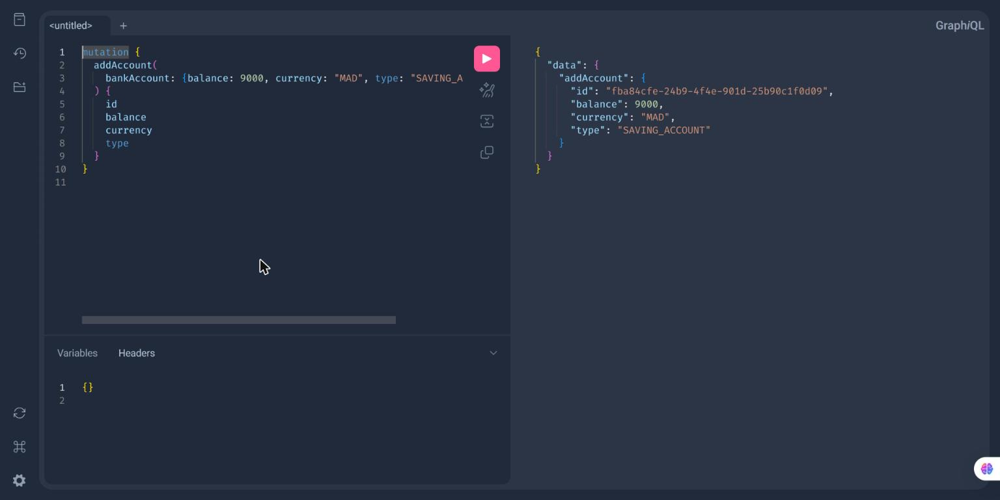

**Mutation updateAccount**

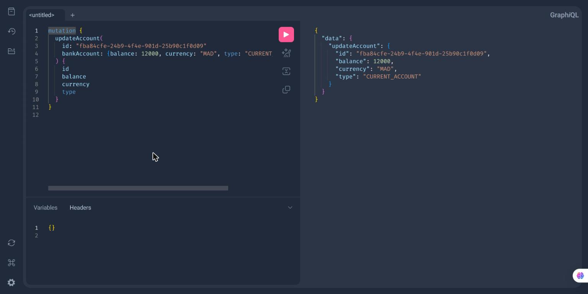

**Mutation deleteAccount**

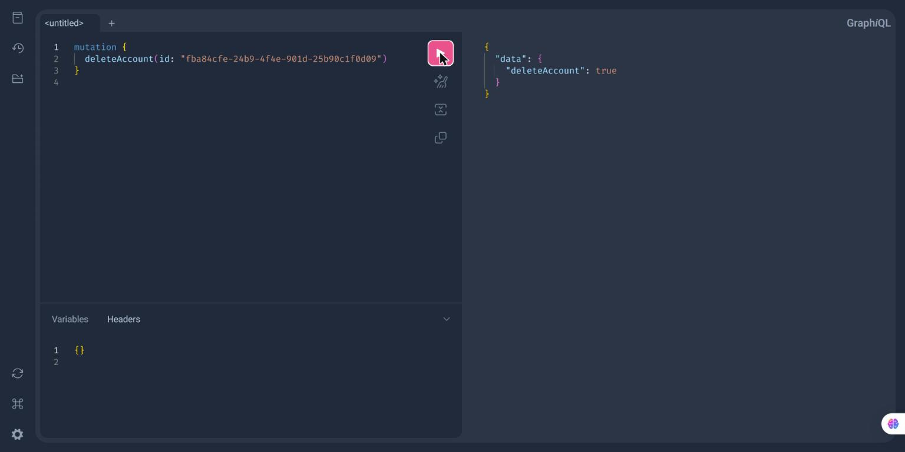

**Gestion d'erreur (compte inexistant)**

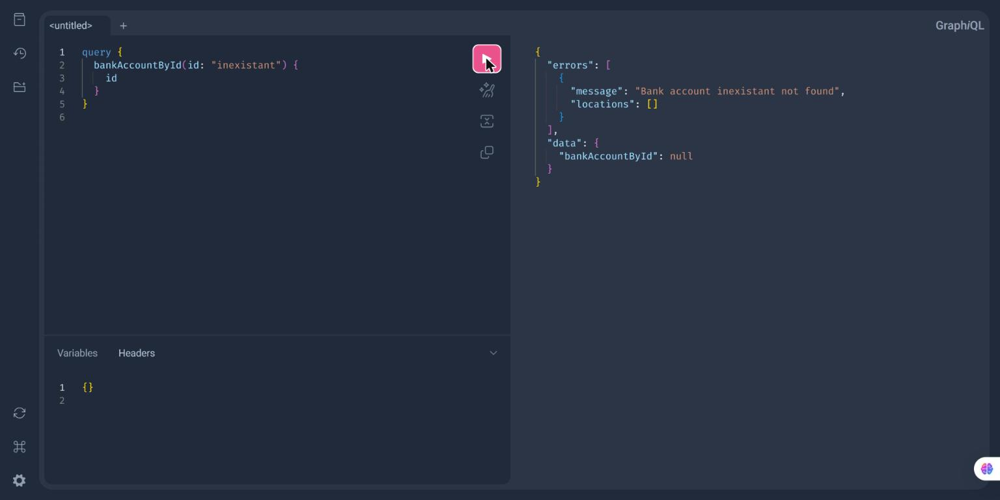

### Base de données H2

**Contenu de la table BANK_ACCOUNT**

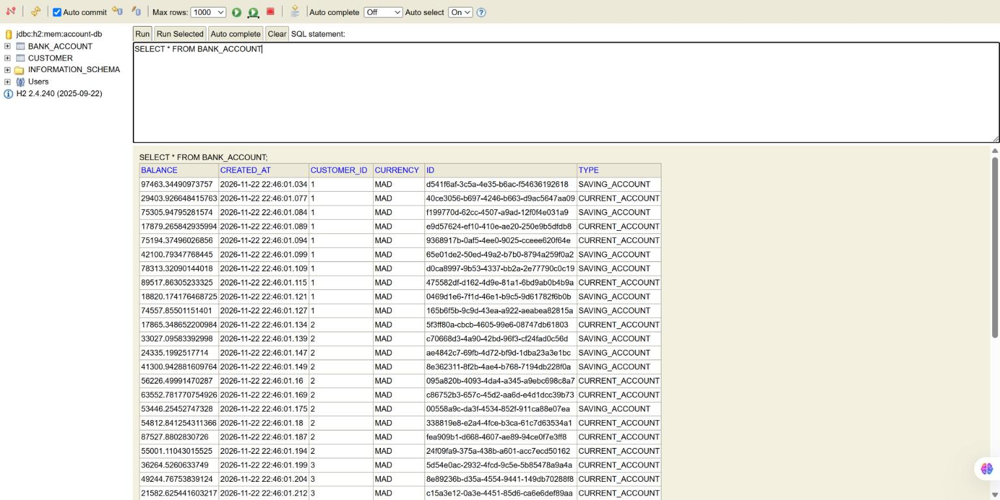
